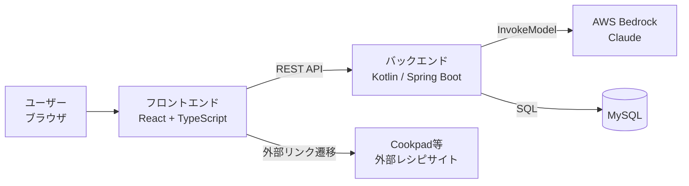
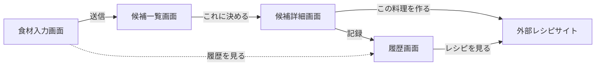
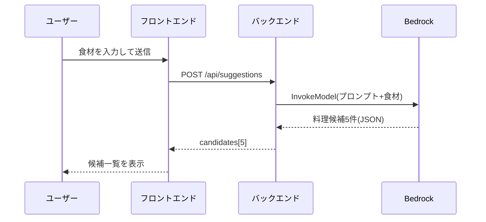
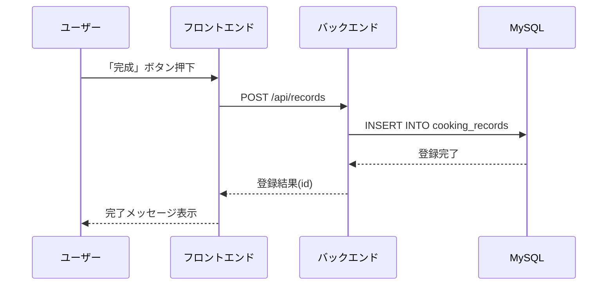
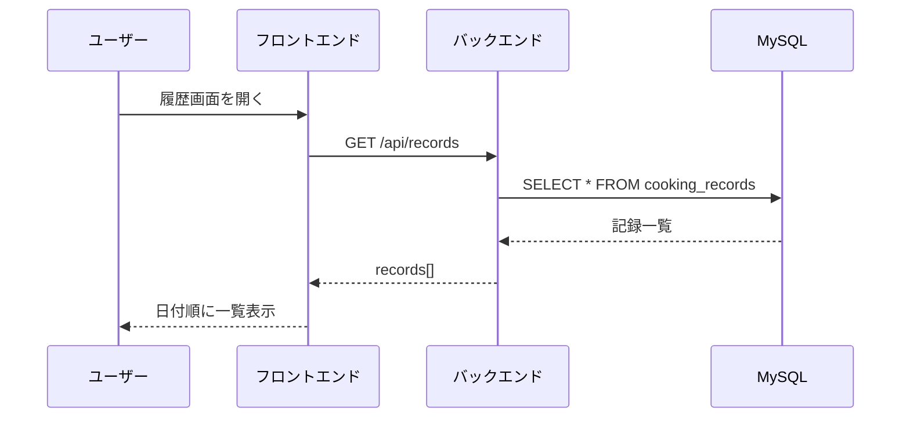

# 献立メーカー 基本設計書

2026-09-17 作成 · @Someone

## システム構成

フロントエンドはブラウザ上で動作し、バックエンド経由でBedrockとMySQLにアクセスします。AWSの認証情報はバックエンドのみが保持します。



| コンポーネント | 役割 |
| --- | --- |
| フロントエンド | 画面表示、ユーザー操作の受付、バックエンドAPI呼び出し |
| バックエンド | ビジネスロジック、Bedrock呼び出し、DB読み書き |
| MySQL | 完成記録(cooking_records)の永続化 |
| AWS Bedrock | 食材から料理候補を生成するAI推論 |
| 外部レシピサイト | 実際のレシピ詳細の閲覧先(自サービスでは保持しない) |

## 画面設計

### 1. 食材入力画面(トップ)

| 項目 | 内容 |
| --- | --- |
| 食材入力欄 | テキスト入力、Enterまたは追加ボタンでタグ状に複数登録 |
| 登録済み食材一覧 | タグ表示、各タグに削除(×)ボタン |
| 送信ボタン | 押下で`/api/suggestions`を呼び、候補一覧画面へ遷移 |
| ローディング表示 | AI応答待ちの間、送信ボタンを無効化しスピナー表示 |
| 履歴へのリンク | 画面上部に履歴画面への導線を常設 |

### 2. 候補一覧画面

| 項目 | 内容 |
| --- | --- |
| 候補カード×5 | 料理名、簡単な説明を表示 |
| 「これに決める」ボタン | 各カードに配置。押下でその候補を選択し、候補詳細画面へ遷移 |
| 再提案ボタン | 気に入った候補がない場合、入力画面に戻って再送信できる導線 |

### 3. 候補詳細画面

| 項目 | 内容 |
| --- | --- |
| 料理名・説明 | 選択した候補の情報を表示 |
| 栄養情報テーブル | カロリー・脂質・糖質・炭水化物の概算値(AI提案時に取得済み) |
| 「この料理を作る」ボタン | 押下で、外部レシピサイトを別タブで開き、同時に当日の日付として`/api/records`に登録する |
| 完了メッセージ | 記録後に表示し、履歴画面へのリンクを添える |
| 「他の候補に戻る」ボタン | 候補一覧画面に戻る導線 |

### 4. 履歴画面

| 項目 | 内容 |
| --- | --- |
| 記録一覧 | 日付(新しい順)・料理名の一覧表示 |
| 「レシピを見る」ボタン | 各行に配置。記録時の`recipe_url`へ遷移 |
| 空状態表示 | 記録が0件のとき「まだ記録がありません」を表示 |



## 機能設計(処理フロー)

### 候補提案フロー



### 完成記録フロー



### 履歴閲覧フロー



## データベース設計

### cooking_records テーブル

| カラム名 | 型 | 制約 | 説明 |
| --- | --- | --- | --- |
| id | BIGINT | PK, AUTO_INCREMENT | レコードID |
| dish_name | VARCHAR(255) | NOT NULL | 料理名 |
| recipe_url | VARCHAR(1024) | NOT NULL | 遷移先レシピURL(再訪問用) |
| cooked_on | DATE | NOT NULL | 作った日付 |
| created_at | TIMESTAMP | NOT NULL, DEFAULT CURRENT_TIMESTAMP | 記録日時 |

**インデックス**: `cooked_on`に対してINDEXを付与し、履歴一覧の日付順取得を高速化する。

```sql
CREATE TABLE cooking_records (
    id BIGINT PRIMARY KEY AUTO_INCREMENT,
    dish_name VARCHAR(255) NOT NULL,
    recipe_url VARCHAR(1024) NOT NULL,
    cooked_on DATE NOT NULL,
    created_at TIMESTAMP NOT NULL DEFAULT CURRENT_TIMESTAMP,
    INDEX idx_cooked_on (cooked_on)
);
```

ユーザーごとの履歴分離(user_idカラム追加)は要件定義書のコメントで確認中のため、方針が決まり次第この設計を更新します。

## 外部インターフェース設計

### Bedrock呼び出し仕様

バックエンドがAWS SDKでBedrockの`InvokeModel`を呼び出します。応答をそのままフロントに返せるよう、Claudeにはプレーンテキストではなく**JSON配列のみ**を返すよう指示します。

| 項目 | 内容 |
| --- | --- |
| モデル | Claudeシリーズ(モデルIDは事前共有) |
| リージョン | 事前共有のリージョンを使用 |
| 入力プロンプト例 | 「食材: 卵, 玉ねぎ。この食材で作れる料理を5つ、name/descriptionを持つJSON配列のみで出力してください」 |
| 期待する出力 | `[{"name": "オムライス", "description": "...", "calories": 450, "fat": 15, "sugar": 40, "carbs": 55}, ...]`(5件) |
| パース失敗時 | 再試行1回、それでも失敗したらエラーレスポンスを返す |

### レシピ検索URL生成仕様

公式APIがないため、料理名からサイト内検索URLをバックエンドで組み立てます。

| サイト | URLパターン |
| --- | --- |
| クックパッド | `https://cookpad.com/search/{料理名をURLエンコード}` |
| クラシル | `https://www.kurashiru.com/search?query={料理名をURLエンコード}` |

どちらのサイトを使うかはチームで選択し、`recipeUrl`としてレスポンスに含めます。

## 内部API仕様

### POST /api/suggestions

| 項目 | 内容 |
| --- | --- |
| リクエスト | `{"ingredients": ["卵", "玉ねぎ"]}` |
| 正常応答(200) | `{"candidates": [{"name": "...", "description": "...", "calories": 450, "fat": 15, "sugar": 40, "carbs": 55, "recipeUrl": "..."}]}`(5件) |
| 異常応答(400) | `{"error": "ingredients is required"}` (食材未入力) |
| 異常応答(502) | `{"error": "AI提案の取得に失敗しました"}` (Bedrock呼び出し失敗) |

### POST /api/records

| 項目 | 内容 |
| --- | --- |
| リクエスト | `{"dishName": "オムライス", "recipeUrl": "...", "cookedOn": "2026-09-17"}` |
| 正常応答(201) | `{"id": 1}` |
| 異常応答(400) | `{"error": "dishName is required"}` など必須項目欠落時 |

### GET /api/records

| 項目 | 内容 |
| --- | --- |
| クエリ | なし(必要なら`?limit=`で件数制限を追加検討) |
| 正常応答(200) | `[{"id": 1, "dishName": "オムライス", "recipeUrl": "...", "cookedOn": "2026-09-17"}]`(`cooked_on`降順) |

共通方針として、エラー応答は必ず`{"error": string}`の形式に統一します。

## 非機能要件

| 分類 | 方針 |
| --- | --- |
| 性能 | 候補提案APIはBedrock応答待ちで数秒かかる想定。フロントで必ずローディング表示を出す |
| セキュリティ | AWS認証情報はバックエンドの`.env`にのみ保持し、`.gitignore`で除外。フロントには一切渡さない |
| CORS | ローカル開発時、フロント(例: localhost:5173)からバックエンド(例: localhost:8080)へのアクセスを許可する設定をバックエンド側に入れる |
| エラーハンドリング | Bedrock呼び出し失敗時はユーザーに「候補の取得に失敗しました。もう一度お試しください」を表示し、原因はバックエンドのログに出力する |
| 可用性・スコープ | 研修当日はローカル起動のみを対象とし、本番相当の可用性・冗長化は考慮しない |

研修という位置づけのため、大規模アクセスやセキュリティ攻撃への耐性は設計対象外とします。

## 開発・実行環境

フロントエンド・バックエンド・DBをすべてDocker Composeで起動する構成に統一しました。環境差によるトラブルを防ぐことを優先します。

### ディレクトリ構成

```
menu-maker/
├─ frontend/          # React + TypeScript
├─ backend/            # Kotlin (Spring Boot)
├─ docker-compose.yml
└─ README.md
```

### docker-compose.yml

```yaml
services:
  mysql:
    image: mysql:8.0
    environment:
      MYSQL_DATABASE: menu_maker
      MYSQL_ROOT_PASSWORD: password
    ports:
      - "3306:3306"
    volumes:
      - mysql_data:/var/lib/mysql
    healthcheck:
      test: ["CMD", "mysqladmin", "ping", "-h", "localhost"]
      interval: 5s
      retries: 10

  backend:
    build: ./backend
    env_file: ./backend/.env
    environment:
      DB_URL: jdbc:mysql://mysql:3306/menu_maker
    volumes:
      - ./backend:/app
      - gradle_cache:/root/.gradle
    ports:
      - "8080:8080"
    depends_on:
      mysql:
        condition: service_healthy

  frontend:
    build: ./frontend
    volumes:
      - ./frontend:/app
      - /app/node_modules
    ports:
      - "5173:5173"
    command: npm run dev -- --host 0.0.0.0
    depends_on:
      - backend

volumes:
  mysql_data:
  gradle_cache:
```

### 環境変数一覧(backend/.env)

AWSへの認証は2方式のいずれかで行います。両方設定した場合はAPIキー方式が優先されます。

| 変数名 | 説明 |
| --- | --- |
| AWS_BEARER_TOKEN_BEDROCK | 【方式A・推奨】Bedrock APIキー(ベアラートークン)。Claude Code等と共通のキーを使い回せる |
| AWS_ACCESS_KEY_ID | 【方式B】Bedrock呼び出し用のアクセスキー(方式Aを使う場合は不要) |
| AWS_SECRET_ACCESS_KEY | 【方式B】Bedrock呼び出し用のシークレットキー(方式Aを使う場合は不要) |
| AWS_REGION | Bedrockが有効なリージョン |
| BEDROCK_MODEL_ID | 使用するClaudeのモデルID(リージョンによっては`jp.anthropic....`のような推論プロファイルID) |
| DB_URL | MySQL接続先(Docker Compose利用時は`jdbc:mysql://mysql:3306/menu_maker`) |
| DB_USER / DB_PASSWORD | MySQL接続用の認証情報 |

`.env`は`.gitignore`に必ず追加し、`.env.example`をテンプレートとしてリポジトリに含めます。

### 前日までの準備

- `docker compose up`が通ることを自分の手元で確認しておく
- 6人全員に前日中に`docker compose build`まで済ませてもらう
- Docker Desktopのインストール確認を前日のうちに済ませてもらう
