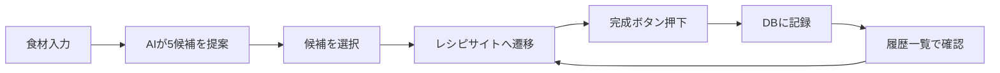
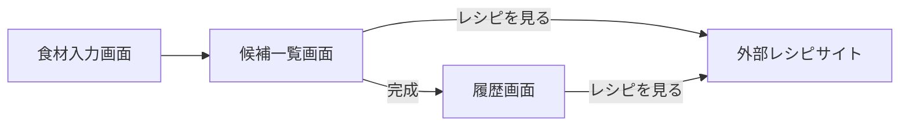

# 献立メーカー 要件定義書

2026-09-17 作成 · @Someone

## プロジェクト概要

献立メーカーは、冷蔵庫にある食材を入力すると、作れる料理の候補を5件提案するWebアプリです。選んだ候補は外部レシピサイトに遷移でき、実際に作った料理は日付付きで記録・再閲覧できます。

- **想定ユーザー**: 献立を考えるのが面倒な人。今回は新人エンジニア研修の題材として、フロント・バックエンド・DB・AI連携を一通り体験することが目的
- **コア体験**: 食材入力 → AIによる5候補提案 → 外部レシピサイトへ遷移 → 完成記録 → 履歴からの再訪問

## 技術スタック

| レイヤー | 技術 | 備考・提案 |
| --- | --- | --- |
| フロントエンド | React + TypeScript | Vite構成を推奨。UIライブラリは自由(MUI、Tailwindなど) |
| バックエンド | Kotlin | フレームワークは Spring Boot を推奨(学習情報が多く、新人でも詰まりにくい) |
| DB | MySQL | ローカルは Docker Compose で起動し、環境差をなくす |
| AI連携 | AWS Bedrock(Claude) | バックエンド経由で呼び出す。フロントにAWS認証情報を持たせない |
| レシピ遷移先 | Cookpad / クラシル等 | 公式APIがないため、検索URL方式を採用(詳細は「不足要件」参照) |
| 実行環境 | Docker Composeでフロント・バックエンド・MySQLを一括起動(詳細は基本設計書を参照)。AWSへのデプロイは行わない |  |

**認証情報の扱い**: AWSのアクセスキーはバックエンドの`.env`にのみ置き、`.gitignore`で除外する。BedrockのモデルIDとリージョンは事前に共有しておく。

## 機能要件

1. **食材入力**: 持っている食材をテキストで複数入力できる
2. **候補提案**: 入力食材をもとに、AI(Bedrock)が作れる料理を5件提案する(料理名・簡単な説明)
3. **レシピ遷移**: 候補を選択すると、対応するレシピサイトのページに遷移する(新しいタブで開く)
4. **完成記録**: 「完成」ボタン押下で、日付・料理名・レシピURLをDBに記録する
5. **履歴閲覧**: 過去に記録した「いつ・何を作ったか」の一覧を表示する
6. **再訪問**: 履歴の各項目から「レシピを見る」ボタンで、記録時のレシピページに再度遷移できる

## 画面構成

| 画面名 | 概要 | 主な要素 |
| --- | --- | --- |
| 食材入力画面(トップ) | 食材を入力して提案をリクエストする画面 | 食材入力欄(複数可)、送信ボタン |
| 候補一覧画面 | AIが提案した5件の料理を表示する画面 | 料理名・説明、「レシピを見る」ボタン、「完成」ボタン(各候補ごと) |
| 履歴画面 | 過去に作った料理の記録一覧 | 日付・料理名の一覧、「レシピを見る」ボタン(各行) |

## データベース設計

食材やAIの提案結果は保存せず、「実際に完成した料理」だけを1テーブルで記録するシンプルな構成にします。

**cooking_records テーブル**

| カラム名 | 型 | 説明 |
| --- | --- | --- |
| id | BIGINT (PK, AUTO_INCREMENT) | レコードID |
| dish_name | VARCHAR(255) | 料理名 |
| recipe_url | VARCHAR(1024) | 遷移先レシピURL(再訪問用) |
| cooked_on | DATE | 作った日付 |
| created_at | TIMESTAMP | 記録日時(default CURRENT_TIMESTAMP) |

ユーザーごとに履歴を分けるか(user_idカラムを足すか)は「不足要件」で検討します。

## API設計

| メソッド | パス | 説明 | リクエスト例 | レスポンス例 |
| --- | --- | --- | --- | --- |
| POST | /api/suggestions | 食材からAIが5候補を提案 | `{"ingredients": ["卵", "玉ねぎ"]}` | `{"candidates": [{"name": "オムライス", "description": "...", "recipeUrl": "..."}]}` (5件) |
| POST | /api/records | 完成記録を作成 | `{"dishName": "オムライス", "recipeUrl": "...", "cookedOn": "2026-09-17"}` | `{"id": 1}` |
| GET | /api/records | 記録一覧を取得 | なし | `[{"id": 1, "dishName": "オムライス", "recipeUrl": "...", "cookedOn": "2026-09-17"}]` |

`/api/suggestions`はBedrockにJSON形式での回答を指示するプロンプト設計が肝になります(構造化出力)。

## 不足していた要件・決めるべきこと

1. **レシピサイトへの遷移方法**: Cookpad/クラシルに公式APIはなく、特定レシピへの直接リンクは技術的に作れません。「料理名でサイト内検索した結果ページ」へのリンクをAIに生成させる方式が現実的です(例: `https://cookpad.com/search/オムライス`)。
2. **AIの提案ロジック**: Bedrock Claudeに5件をJSON配列で返させるプロンプト設計と、パース失敗時のフォールバックが必要です。
3. **認証・ユーザー識別**: 研修用途なら認証なしで全員共有のDBを使うか、簡易的にユーザー名だけ入力させて履歴を分けるかを決める必要があります。
4. **入力バリデーション**: 食材が空欄の場合や、不正な文字列が入力された場合の挙動を決めます。
5. **ローカル開発環境**: Docker Composeでフロント・バックエンド・MySQLをまとめて起動する方針に決定しました。詳細は基本設計書の「開発・実行環境」を参照してください。
6. **AWS認証情報の配布**: チームごとにIAMユーザーを発行するか、共通のキーを使い回すかを前日までに決めておく必要があります。
7. **エラーハンドリング**: Bedrock呼び出しがエラー・タイムアウトした場合の画面表示を決めます。
8. **デザインの範囲**: UIライブラリを使うか、時間配分上どこまで作り込むかをチームで最初に決めます。

## チーム体制・進行スケジュール

6人を3人×2チームに分け、各チームが1つのアプリを完成させます。

| 役割 | 人数 | 担当 |
| --- | --- | --- |
| バックエンド | 1人 | Kotlin API、Bedrock呼び出し、DB接続 |
| フロントエンド | 2人 | 入力・候補一覧画面 / 履歴画面で分担 |

**4時間の進行スケジュール**

| 時間 | 内容 |
| --- | --- |
| 0:00-0:20 | チームでお題確認・役割分担・環境確認 |
| 0:20-0:50 | Bedrock疎通確認、DB起動確認(まず「Hello」が返ることを確認) |
| 0:50-3:00 | 並行開発(フロントはモックデータで先行、バックエンド完成後に接続) |
| 3:00-3:30 | フロント⇔バックエンド統合、動作確認 |
| 3:30-3:50 | README・デモ動画/スクショ作成 |
| 3:50-4:00 | 2チームで成果発表 |
